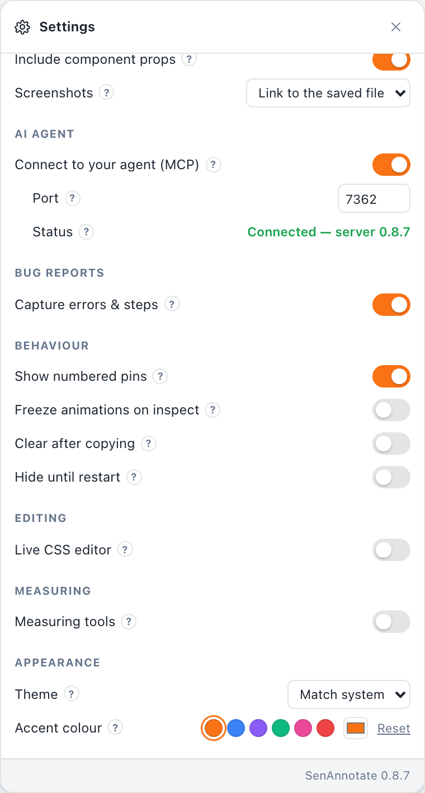

# Agent Connection (MCP)

*Copy report* hands your agent a snapshot. The agent connection hands it the notes
themselves: it reads them when it needs them, sees each screenshot as an image, and marks
each note done as it fixes it — the tick appears in your open tab while you watch.

It works with any agent that speaks [MCP](https://modelcontextprotocol.io): Claude Code,
Cursor, Codex, Claude Desktop and most others.

---

## Setting it up

**1. Get the server.** One file, `senannotate-mcp.mjs`, with no dependencies. It needs
Node 22 or later. Take it from a [release](https://github.com/thangnm93/SenAnnotate/releases)
(`senannotate-mcp-<version>.mjs`), or build it: `npm run build` writes
`dist-mcp/senannotate-mcp.mjs`.

**2. Tell your agent about it.** Claude Code:

```bash
claude mcp add senannotate -- node /absolute/path/to/senannotate-mcp.mjs
```

Agents configured with JSON (Cursor, Claude Desktop, …):

```json
{
  "mcpServers": {
    "senannotate": { "command": "node", "args": ["/absolute/path/to/senannotate-mcp.mjs"] }
  }
}
```

The agent starts the server itself whenever it starts. There is nothing to keep running.

**3. Switch it on in Chrome.** On any page: toolbar → gear → *AI agent* → **Connect to your
agent (MCP)**. The *Status* row says **Connected** once the extension has found the server.
See [[Settings]].



**Installed unpacked** (from a release zip, or from source) rather than from the Web Store?
The server trusts only the Web Store build until told otherwise, and *Status* says
**Refused — start the server with `SENANNOTATE_EXTENSION_ID=<id>`**. Give it that id:

```bash
claude mcp add senannotate -e SENANNOTATE_EXTENSION_ID=<id> -- node /absolute/path/to/senannotate-mcp.mjs
```

or add `"env": { "SENANNOTATE_EXTENSION_ID": "<id>" }` beside `args` in a JSON config. Then
restart the agent session and reload the tab.

---

## What the agent can do

| Tool | |
|---|---|
| `list_annotations` | The open notes on every page, or one — id, kind, the note, the element, the source file. Pass `status: "all"` to include the ones already done. |
| `get_report` | The Markdown report, the same one *Copy report* builds, at any detail level. Images are named rather than inlined; a list of ids is appended. |
| `get_annotation` | One note in full, with its **screenshot** (how it looks now) and **reference images** (how it should look) as images the agent can see. |
| `set_status` | Mark notes `done`, or `open` again. Your tab updates without a reload. |

What it **cannot** do: create notes, edit them, or delete them. Only you remove notes —
with *Clear all* or *Clear after copying* — and the agent is not a third way.

Ask it in plain words: *"fix the open SenAnnotate notes on /checkout and mark each one done"*.

---

## Several agents at once

Each agent session starts its own server, and only one can own the port. The first one
does; every later one relays through it. When the first agent exits, another takes the
port over and the extension reconnects to it within a few seconds. Nothing to configure.

---

## Privacy and security

- **Off by default.** With the switch off, the extension opens no connection of any kind.
- **This computer only.** The extension connects to `127.0.0.1`. The host is not a
  setting — only the port is — so the notes cannot be pointed anywhere else.
- **Not reachable from web pages.** Any page you visit can try to talk to `127.0.0.1`. The
  server refuses every connection that comes from a web page, and checks the `Host` header
  so a DNS-rebinding page is refused too.
- **Not reachable from other extensions.** Another extension you have installed could dial
  the same port. The server trusts only the Web Store build of SenAnnotate and the ids you
  list in `SENANNOTATE_EXTENSION_ID`; anything else is refused and nothing it sends reaches
  the agent.
- **Memory only.** The server writes nothing to disk; it holds the latest notes the
  browser sent and forgets them when it exits.
- **Your agent's model sees what the agent reads** — exactly as it would see a report you
  pasted into it.

The full statement is in the [privacy policy](https://github.com/thangnm93/SenAnnotate/blob/main/PRIVACY.md).

---

## When it does not connect

| Status says | |
|---|---|
| *Nothing on port 7362* | No agent is running the server. Start (or restart) the agent session, then reload the tab. |
| *Refused — start the server with SENANNOTATE_EXTENSION_ID=…* | This is an unpacked copy. Add that id to the server's environment (see *Setting it up*), restart the agent, reload the tab. |
| *Connected* but the agent sees nothing | The notes are on a different page key — `list_annotations` without a `url` shows every page. |
| The agent says *port in use by another program* | Something else has 7362. Set `SENANNOTATE_MCP_PORT` in the agent's server config **and** the same number in *Port*. |

**Chrome 116 or later** keeps the connection open while the browser is idle. On Chrome
111–115 the background worker sleeps after 30 seconds and the connection drops with it;
it comes back on the next page load, so reload a tab before asking the agent.

Console errors, failed requests and the steps to reproduce are not available over the
connection: they live only in the page's memory and are never stored. Copy a single page's
report from its toolbar when you need them.
